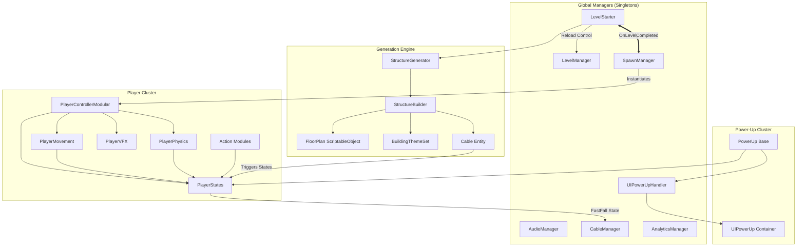

# Running Late - Project Architecture & Documentation

## 🏃 Project Overview
**Running Late** is a fast-paced Unity 2D platformer (with stylized anime/isometric visuals) where the player navigates procedural urban environments, overcomes hazards, collects power-ups, and reaches the school before time runs out.

---

## 📊 Scene Architecture & Class Relationships

---

## 🔗 Dependency Matrix

| System | Depends On | Responsible For |
| :--- | :--- | :--- |
| **LevelStarter** | `StructureGenerator`, `SpawnManager`, `LevelManager` | Global level lifecycle, Seed management, Module layout. |
| **SpawnManager** | `LevelStarter`, `PlayerControllerModular` | Player instantiation, Countdown sequence, Respawn logic. |
| **PlayerControllerModular** | `PlayerStates`, `PlayerMovement`, `ActionModules`, `PlayerVFX` | Input dispatching to physics, animation states, and VFX triggers. |
| **StructureBuilder** | `FloorPlan`, `BuildingThemeSet`, `FloorAssetPicker` | Procedural building construction, facade randomization, and depth sorting. |
| **FloorPlan (SO)** | `BuildingThemeSet`, `PowerUps`, `ColorMaterials` | Centralized single-source-of-truth for building sizes, themes, and spawn rates. |
| **UIPowerUpHandler** | `UIPowerUp`, `PowerUpContract` | Power-up HUD queue, cooldown timers, and priority resolution. |
| **CableManager** | `Cable`, `PlayerStates` | Global cable physics state (Trigger vs Solid) and slide coordination. |
| **PlayerStates** | `PlayerConfig` | Centralized data container for all active player variables and timers. |

---

## 🛠️ System Architecture

### 1. Player System (`Assets/Scripts/Player`)
Modular, decoupled architecture to avoid "God Classes":
- **`PlayerControllerModular`**: Central coordinator for input, actions, and camera target.
- **`PlayerStateManager`**: Evaluates active states (Grounded, WallRunning, Sliding, Rolling).
- **`PlayerStates`**: Centralized runtime data container for all player states, power-up flags, and timers.
- **`PlayerMovement` & `PlayerPhysics`**: Core locomotion, horizontal forces, and collision physics.
- **`PlayerJump`, `PlayerDive`, `PlayerWallClimb`, `PlayerKick`**: Specialized action modules.
- **`PlayerVFX`**: Manages dust and trail particle systems in world space without lifecycle leaks.
- **`PlayerConfig` (ScriptableObject)**: Centralizes physics and movement tuning.

### 2. Procedural Level & Facade Generation (`Assets/Scripts/Floors` & `Modules`)
- **Centralized `FloorPlan` Architecture**: Single source of truth for both `SingleDecker` and `DoubleDecker` building modes (`SlimBuildingConfig.asset`, `MediumBuildingConfig.asset`, `WideBuildingConfig.asset`).
- **`BuildingThemeSet`**: ScriptableObject bundles defining Ground, Mid-Floor, and Roof prefabs for distinct visual sets (Set 1 to Set 5 for Slim and Medium buildings).
- **Progressive Depth Sorting**: Decremental `sortingOrder -= floorIndex` across SpriteRenderers and Tilemaps for clean isometric layering.
- **Anti-Repeat Logic (`BuildingPoolConfig`)**: Prevents identical adjacent building facades.

### 3. Power-Up System (`Assets/Scripts/PowerUps` & `UI`)
- **Base `PowerUp`**: Handles trigger collection, float-and-fade pickup visual effects, and sound playback.
- **Active Power-Ups (8 Total)**:
  - `DoubleJump`: Grants an extra mid-air jump.
  - `Shield` (Gum): Bubble shield absorbing one hit.
  - `ExtraSpeed` (Headphones): Boosts max running speed.
  - `Invincibility`: Temporary complete damage immunity.
  - `ExtraHeight`: Super jump boost.
  - `AirFloat`: Slow-fall gliding while holding jump.
  - `Toast` (Heal): Restores toast/life immediately.
  - `ExtraTime`: Adds +10 seconds to the level timer.
- **UI Feedback (`UIPowerUpHandler` & `UIPowerUp`)**:
  - Elastic pop-in animation (*EaseOutBack*) when appearing or refreshing.
  - High-contrast styling (`#1E2438` bold text, 88% card opacity) ensuring crystal-clear legibility against any background.
- **Testing Sandbox (`Assets/Scenes/Testing/PowerUpTesting.unity`)**:
  - Independent flat testing track with `PowerUpTester.cs` (keys `1..8`, `R` for instant testing and on-screen debug GUI).

### 4. Obstacle & Hazard System (`Assets/Scripts/Obstacles`)
- **`Animals`**: AI-driven dynamic hazards (Dogs, Cats, Pigeons).
- **`Vehicles`**: Physics-based obstacles, some interactively kickable.
- **`Barriers`**: Static kinetic obstacles.
- **`ObstacleWarningManager`**: Proximity hazard alerts.

### 5. Analytics & Steam Integration (`Assets/Scripts/Analytics` & `Plugins/Steamworks`)
- **`AnalyticsManager`**: Event tracking via `GameAnalytics` (level progress, actions, UI events).
- **`SteamManager`**: Facepunch.Steamworks integration with App ID `4724080`.

---

## 📁 Key Directory Structure

- **`Assets/Scripts/`**: All C# source code organized by domain (`Player`, `Floors`, `PowerUps`, `UI`, `Utils`).
- **`Assets/Prefabs/`**: Production-ready prefabs (`Player`, `Power-Ups`, `Floors`, `Modules`, `UI`).
- **`Assets/Scenes/`**:
  - `ModularLevel.unity`: Main procedural gameplay level.
  - `MainMenu.unity`: Menu and seed selector.
  - `Testing/PowerUpTesting.unity`: Standalone sandbox for mechanics & power-ups.
- **`Assets/Sprites/`**: Artwork, UI textures, and facade sprite collections.
- **`docs/`**: Integration guides (`TODO.md`, `steamworks_integration.md`).
