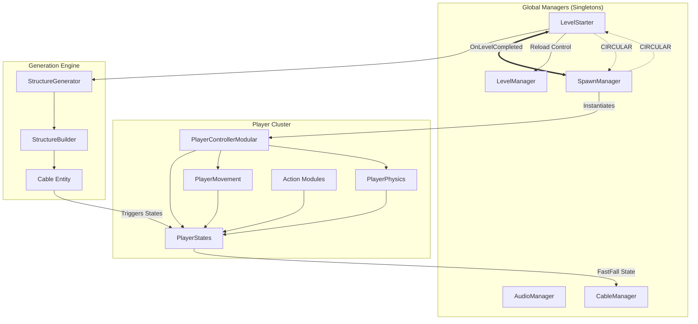

# Running Late - Project Architecture & Documentation

## 🏃 Project Overview
**Running Late** is a fast-paced Unity 2D platformer (with isometric visuals) where the player must navigate through procedural urban environments, overcoming obstacles and using power-ups to reach the goal before time runs out.

## 📊 Scene Architecture & Class Relationships

This diagram illustrates how systems interact and where potential tight coupling exists.

> [!WARNING]
> **Circular Dependency Detected**: `LevelStarter` and `SpawnManager` depend on each other for coordinates and lifecycle events. This can lead to initialization race conditions.

---

## 🔗 Dependency Matrix

| System | Depends On | Responsible For |
| :--- | :--- | :--- |
| **LevelStarter** | `StructureGenerator`, `SpawnManager`, `LevelManager` | Global level lifecycle, Seed management, Module layout. |
| **SpawnManager** | `LevelStarter`, `PlayerControllerModular` | Player instantiation, Countdown sequence, Respawn logic. |
| **PlayerController** | `PlayerStates`, `PlayerMovement`, `ActionModules` | Mapping Input System to State changes and Physics calls. |
| **CableManager** | `Cable`, `PlayerStates` | Global cable physics state (Trigger vs Solid) and coordination. |
| **PlayerStates** | `PlayerConfig` | Centralized "Source of Truth" for all player variables and timers. |

---

## 🛠️ System Architecture

The project follows a modular and manager-based architecture, utilizing Unity's modern **Input System** and **ScriptableObjects** for flexible configuration.

### 1. Player System (`Assets/Scripts/Player`)
The player is the most complex system, divided into specialized components to avoid "God Classes":
- **`PlayerControllerModular`**: The central hub that coordinates input and component communication.
- **`PlayerStateManager`**: Manages complex states like sliding, wall-running, and rolling.
- **`PlayerStates`**: A data container for all active player states and timers.
- **`PlayerMovement` & `PlayerPhysics`**: Handle the core locomotion and collision logic.
- **`PlayerJump`, `PlayerDive`, `PlayerWallClimb`, `PlayerKick`**: Modular action components that implement specific mechanics.
- **`PlayerConfig` (ScriptableObject)**: Centralizes all tuning parameters (speeds, forces, timings).

### 2. UI System (`Assets/Scripts/UI`)
Uses a hierarchical panel system:
- **`UIManager`**: A singleton that manages transitions between `PauseMenu`, `VictoryPanel`, and `DefeatPanel`.
- **`MainMenuPanel` & `MainMenuController`**: Handle the multi-step flow of the main menu (Play -> Seed Selection -> Start).
- **`HUD / UIPowerUp`**: Real-time feedback for active power-ups and game progress.

### 3. Procedural Level Generation (`Assets/Scripts/Floors` & `Modules`)
- **`StructureGenerator` & `StructureBuilder`**: Create the level layout based on procedural rules.
- **`FloorPlan` & `ModulePlan`**: Define the blueprint for how level segments (modules) are assembled.
- **`CableManager`**: Manages the dynamic "cables" the player can slide on.

### 4. Obstacle & Hazard System (`Assets/Scripts/Obstacles`)
Environmental challenges are separated by type:
- **`Animals`**: AI-driven hazards (Dogs, Cats, Pigeons) with specialized behaviors.
- **`Vehicles`**: Physics-based obstacles, some interactive (kickable).
- **`Barriers`**: Static or simple kinetic obstacles.
- **`IWarningIndicator`**: Interface for hazard proximity alerts.

### 5. Power-Up System (`Assets/Scripts/PowerUps`)
A flexible, inheritance-based system described in its own [README](file:///Volumes/DiscoAccesoRapido/UnityExternalJobs/unbreakable/running_late/Assets/Scripts/PowerUps/README.md):
- **`PowerUp`**: Abstract base handling collection and common logic.
- **Timed Effects**: `DoubleJump`, `ExtraSpeed`, `Invincibility`, `Shield`.
- **Instant Effects**: `ExtraTime`, `ScoreBoost`.
- **Templates**: Includes `.txt` templates for rapid creation of new power-up types.

### 6. Analytics & Data Layer (`Assets/Scripts/Analytics` & `SavedData`)
A decoupled tracking and persistence system:
- **`AnalyticsManager`**: Swappable providers (`Unity`, `GameAnalytics`, `Custom`).
- **`AnalyticsPersistence`**: Handles session buffering and recovery.
- **`LevelSaveData`**: Manages serialized state for level progress and player settings.

### 7. Management & Utilities (`Assets/Scripts/Utils` & `Audio`)
- **`AudioManager`**: Singleton for SFX and Music collection management.
- **`LevelManager`**: Handles scene reloading, replaying with seeds, and level flow.
- **`GameLogger`**: Centralized custom logging for cleaner debugging across systems.

---

## 🕹️ Core Mechanics & Operations

1. **Input Pipeline**: `PlayerInputActions` -> `PlayerControllerModular` -> Specific Sub-Components.
2. **State Logic**: `PlayerStateManager` evaluates active states (Grounded, WallRunning, etc.) every frame.
3. **Physics/Locomotion**: Forces applied via `Rigidbody2D` using parameters from `PlayerConfig`.
4. **Data-Driven Flow**: Logic is decoupled from data; changing a ScriptableObject in the `Configs/` folder updates behavior without code changes.

---

## 📐 Design Patterns Used

- **Singleton Pattern**: Global managers (`UIManager`, `AudioManager`, `LevelManager`, `AnalyticsManager`).
- **Modular Component Pattern**: Functionality split into specialized, decoupled components.
- **Inheritance-Based Systems**: Used for Power-Ups and Obstacles for shared behaviors.
- **Observer Pattern**: Events and local callbacks for decoupled communication.
- **Provider/Interface Pattern**: Swappable backends (Analytics) and standardized behaviors (`IWarningIndicator`).

---

## 📁 Project Structure (Top-Level)

The project follows a strict separation of concerns at the folder level:
- **`Assets/Scripts/`**: All C# source code, organized by system.
- **`Assets/Configs/`**: Centralized **ScriptableObject** instances (`.asset`) for all system tuning.
- **`Assets/Prefabs/`**: Component-ready objects (Managers, Modules, Player, Obstacles).
- **`Assets/Resources/`**: Runtime-loadable assets (currently minimal, keeping modularity).
- **`Assets/Imported/`**: Third-party assets (Feel, Sirenix, BayatGames, etc.), kept separate from core code.
- **`Packages/`**: Modular dependencies like `Linework` (Outline system) and `Sidekick`.
